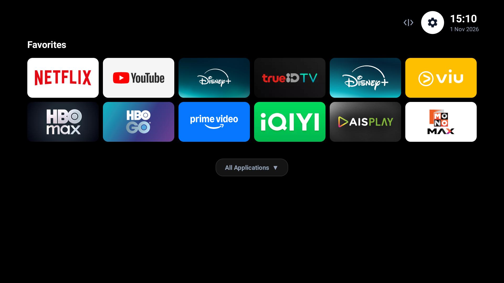
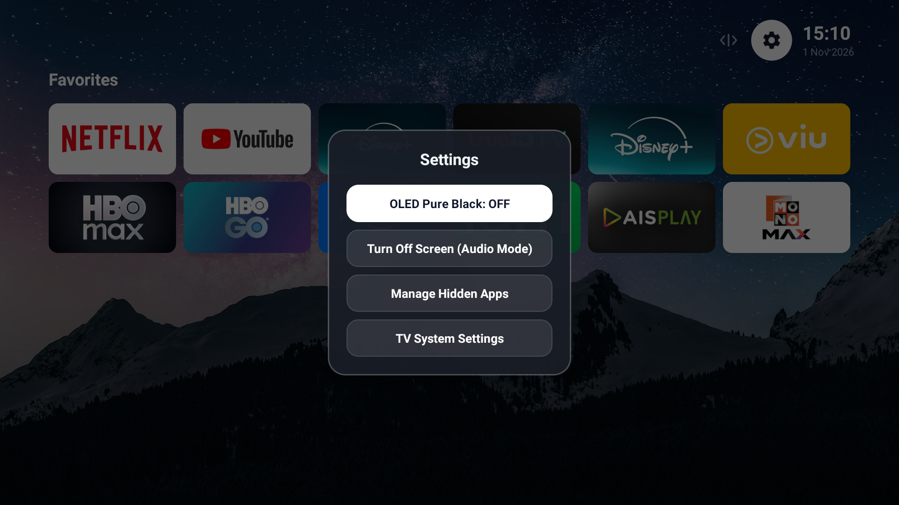
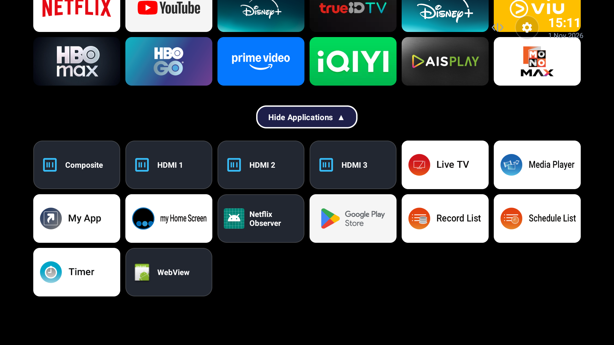

# NuttyFlix Launcher (Android TV) 🚀

<div align="center">
  
  <br/>
  
</div>

> **Ultra-Lightweight, Zero-Ad, Minimalist Custom Launcher for Android TV 11+**
> Tailored specifically for High-Performance OLED / 4K Android TVs (Tested on Panasonic 4K Android TV).


---

## ✨ Features

- **⚡ Blazing Fast Performance:**
  - APK size ~ 780 KB (vs OEM launcher > 80 MB).
  - Cold launch time < 150 ms with zero background lag or stutter.
  - Zero third-party dependencies: Pure native Android SDK (Java + Vector Drawables).
- **🛡️ 100% Ad-Free & Telemetry-Free:**
  - No sponsored feeds, no banners, no background tracking, no network pinging.
- **🎨 FLauncher & Netflix-Style Minimalist Aesthetic:**
  - Iconic curved red **NuttyFlix** wordmark on the top-left and 3D glowing ribbon squircle app icon.
  - Modern 16:9 banner app cards with smooth focus animations (1.08x scale + shadow elevation).
  - Night starry sky wallpaper with dark readable contrast gradient overlay.
  - **🖤 OLED Pure Black Mode:** One-click toggle in settings for pitch black (`#000000`) background (infinite contrast, 0 pixel power, burn-in protection).
  - Top bar featuring real-time **Network Button**, **Input Source Button**, **Settings Gear**, **Live Clock** (`HH:mm`), and **Date** (`d MMM yyyy`).
- **🔌 Animated Unfolding TV Input Switcher:**
  - Dedicated **Input Source Button `[ -> ]`** in the top bar right beside Settings.
  - Clicking it **smoothly unfurls an animated inline ribbon tray** (`Live TV`, `Composite`, `HDMI 1`, `HDMI 2`, `HDMI 3`) with zero disruptive popup dialogs.
  - Pressing Back or navigating away smoothly folds the tray back into the button.
- **📶 Interactive & Expandable Network Tray:**
  - The top bar **Network Button** displays real-time connection status (`<|>` Ethernet / Wi-Fi) and is fully interactive.
  - Clicking it **unfurls an animated inline network drawer** (`Wi-Fi`, `Ethernet`, `Network Settings`), allowing seamless switching and Wi-Fi SSID selection directly from Android TV's native side overlay.
- **👁️ Hide App System:**
  - Hide unwanted system or bloatware apps from your Applications grid via the Hold-OK menu.
  - Manage and unhide apps anytime from the Settings menu.
- **🌙 Screen Off (Audio Mode):**
  - Instant screen-off mode with `0.001f` screen brightness for listening to music on **Spotify** or **YouTube Music** on OLED TVs without panel wear.
  - Press any button on the TV remote to instantly wake the screen back up.
- **🎛️ Interactive Remote Management (D-Pad Optimized):**
  - **Hold OK (Long Press)** on any app card to open the minimal action sheet:
    - `Move`: Enter rearrange mode.
    - `Favorite / Unfavorite`: Pin to Favorites or demote to Applications.
    - `Hide`: Hide app from view.
    - `Detail`: Open Android App Info settings.
    - `Uninstall`: Prompt system uninstall dialog.
  - **Live Rearrange (Move Mode):**
    - Seamless live card swapping using D-Pad Left/Right.
    - Order is immediately persisted into `SharedPreferences`.
    - Zero flickering: Focus is locked onto the moving card.

---

## 📸 Screenshots

| Minimal Home Screen | 🖤 OLED Pure Black Mode |
| :---: | :---: |
|  |  |

| NuttyFlix Settings Dialog | HDMI Inputs & All Applications |
| :---: | :---: |
|  |  |

| Hold OK Management Sheet | Live Rearrange / Move Mode |
| :---: | :---: |
|  |  |

---

## 🎮 Remote Navigation Guide

| Button | Action |
| :--- | :--- |
| **D-Pad Up / Down / Left / Right** | Navigate through app banners smoothly |
| **OK (Short Press)** | Launch selected app or switch to selected HDMI input |
| **OK (Long Press / Hold)** | Open App Management Dialog (`Move`, `Favorite/Unfavorite`, `Hide`, `Detail`, `Uninstall`) |
| **In Move Mode: Left / Right** | Swap card position with neighbor in real-time |
| **In Move Mode: OK / Back** | Confirm and save new app order |
| **Settings Gear (Top Right)** | Opens NuttyFlix Settings Menu (OLED Black, Screen Off Audio Mode, Hidden Apps, System Settings) |

---

## 🚀 Quick Install (Via ADB)

If you already have ADB connected to your Android TV (e.g., `adb connect <TV_IP>:5555`):

```bash
# 1. Install prebuilt APK directly from repository
adb install -r release/NuttyLauncher-v1.0.apk

# 2. Launch NuttyFlix
adb shell am start -n com.nuttyflix.launcher/.MainActivity

# 3. Press HOME on your TV remote and select NuttyLauncher as "Always"
```

---

## 🛠️ Build from Source

### Option A: Ultra-Fast Command Line Build (5 Seconds!)
We provide a standalone PowerShell build pipeline `build_apk.ps1` that uses Android SDK build-tools directly (`aapt2`, `d8`, `javac`, `zipalign`, `apksigner`) without heavy Gradle overhead:

```powershell
powershell -ExecutionPolicy Bypass -File .\build_apk.ps1
```

Output binary: `build/out/NuttyLauncher.apk`

### Option B: Standard Gradle Build
```bash
./gradlew assembleDebug
```

---

## 📖 Detailed Documentation

- 📐 [Architecture & Design Details](docs/ARCHITECTURE.md)
- 🚀 [Panasonic 4K TV Debloating & Optimization Guide](docs/TV_OPTIMIZATION.md)
- 🔨 [Build & Compilation Guide](docs/BUILD_GUIDE.md)

---

## 📄 License

MIT License. Free to use, modify, and distribute.
