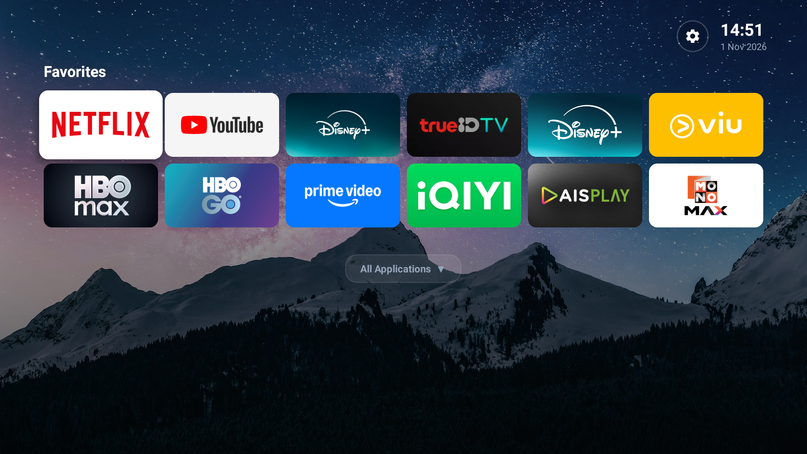
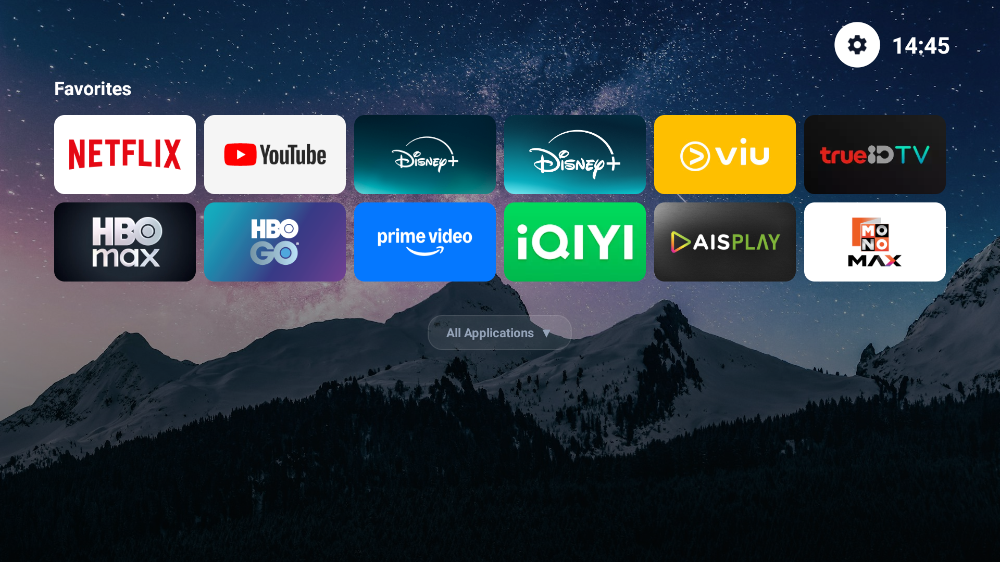
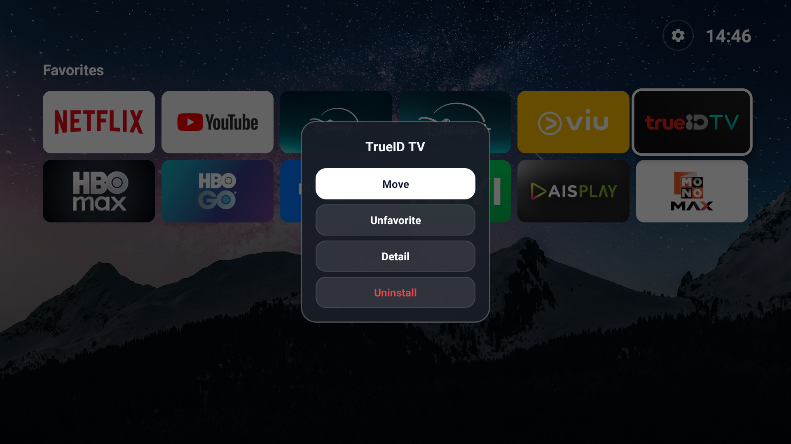
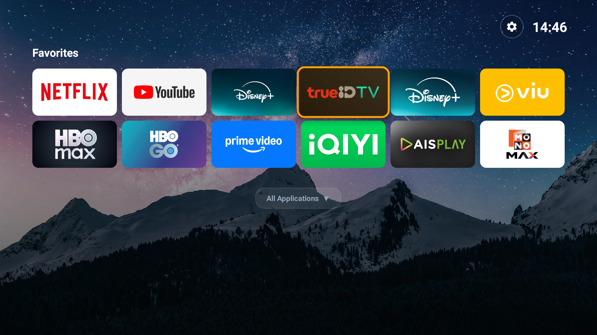

# NuttyFlix Launcher (Android TV) 🚀

> **Ultra-Lightweight, Zero-Ad, Minimalist Custom Launcher for Android TV 11+**
> Tailored specifically for High-Performance OLED / 4K Android TVs (Tested on Panasonic 4K Android TV).



---

## ✨ Features

- **⚡ Blazing Fast Performance:**
  - APK size < 550 KB (vs OEM launcher > 80 MB).
  - Cold launch time < 150 ms with zero background lag or stutter.
  - Zero dependencies: Pure native Android SDK (Java + Vector Drawables).
- **🛡️ 100% Ad-Free & Telemetry-Free:**
  - No sponsored feeds, no banners, no background tracking, no network pinging.
- **🎨 FLauncher Minimalist Aesthetic:**
  - Modern 16:9 banner app cards with smooth focus animations (1.08x scale + shadow elevation).
  - Night starry sky wallpaper with dark readable contrast gradient overlay.
  - Top bar featuring a vector Settings gear button, live clock (`HH:mm`), and date (`d MMM yyyy`).
- **🎛️ Interactive Remote Management (D-Pad Optimized):**
  - **Hold OK (Long Press)** on any app card to open the minimal action sheet:
    - `Move`: Enter rearrange mode.
    - `Favorite / Unfavorite`: Pin to Favorites or demote to Applications.
    - `Detail`: Open Android App Info settings.
    - `Uninstall`: Prompt system uninstall dialog.
  - **Live Rearrange (Move Mode):**
    - Seamless live card swapping using D-Pad Left/Right.
    - Order is immediately persisted into `SharedPreferences`.
    - Zero flickering: Focus is locked onto the moving card.
- **📂 Clean Layout Structure:**
  - **Favorites** placed in the focal center of the screen.
  - **All Applications** collapsed by default (`All Applications ▼`), expandable with a single remote click.

---

## 📸 Screenshots

| Minimal Home Screen | Focus State & Settings |
| :---: | :---: |
|  |  |

| Hold OK Management Dialog | Live Rearrange / Move Mode |
| :---: | :---: |
|  |  |

---

## 🎮 Remote Navigation Guide

| Button | Action |
| :--- | :--- |
| **D-Pad Up / Down / Left / Right** | Navigate through app banners smoothly |
| **OK (Short Press)** | Launch selected app |
| **OK (Long Press / Hold)** | Open App Management Dialog (`Move`, `Unfavorite`, `Detail`, `Uninstall`) |
| **In Move Mode: Left / Right** | Swap card position with neighbor in real-time |
| **In Move Mode: OK / Back** | Confirm and save new app order |
| **Settings Gear (Top Right)** | Opens TV System Settings instantly |

---

## 🚀 Quick Install (Via ADB)

If you already have ADB connected to your Android TV (e.g., `adb connect <TV_IP>:5555`):

```bash
# 1. Install prebuilt APK directly from repository
adb install -r release/NuttyLauncher-v1.0.apk

# 2. Launch NuttyFlix
adb shell am start -n com.nuttyflix.launcher/.MainActivity

# 3. Press HOME on your TV remote and select NuttyLauncher as "Always"
```

---

## 🛠️ Build from Source

### Option A: Ultra-Fast Command Line Build (5 Seconds!)
We provide a standalone PowerShell build pipeline `build_apk.ps1` that uses Android SDK build-tools directly (`aapt2`, `d8`, `javac`, `zipalign`, `apksigner`) without heavy Gradle overhead:

```powershell
powershell -ExecutionPolicy Bypass -File .\build_apk.ps1
```

Output binary: `build/out/NuttyLauncher.apk`

### Option B: Standard Gradle Build
```bash
./gradlew assembleDebug
```

---

## 📖 Detailed Documentation

- 📐 [Architecture & Design Details](docs/ARCHITECTURE.md)
- 🚀 [Panasonic 4K TV Debloating & Optimization Guide](docs/TV_OPTIMIZATION.md)
- 🔨 [Build & Compilation Guide](docs/BUILD_GUIDE.md)

---

## 📄 License

MIT License. Free to use, modify, and distribute.
